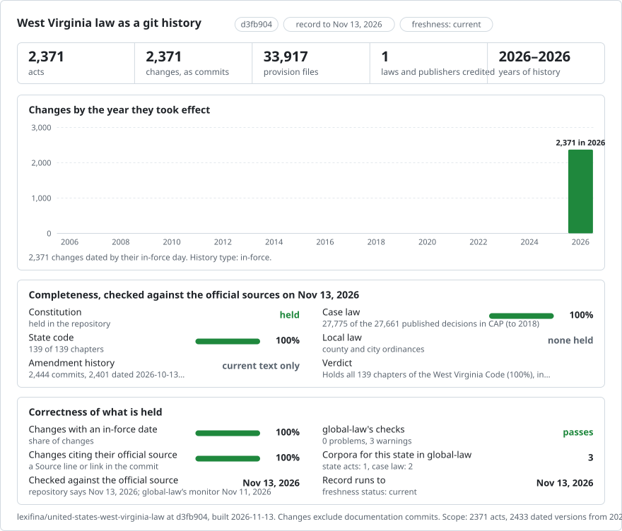

# West Virginia law

<picture>
<source media="(prefers-color-scheme: dark)" srcset="data/effort-dark.svg">

</picture>

The West Virginia Code and Constitution, with earlier complete Code articles as enacted in the Legislature’s Acts volumes.

| Question | Command |
|---|---|
| Inspect history and its dates | `git log --format=fuller -- <article>/` |
| Read the current provision | `git show main:<article>/<section>.md` |

## Earlier history

97 as-enacted article snapshots are recorded without replacing published commits. Correction trailers identify each historical date, source and affected files. These are source snapshots; intervening amendments and full earlier Code editions are not reconstructed.

| Article | Title | Recorded versions |
|---|---|---:|
| `chapter-1-article-0008` | West Virginia Code, CHAPTER 1. THE STATE AND ITS SUBDIVISIONS. ARTICLE 8. RESTRICTIONS ON POWERS OF STATE AGENCIES AND POLITICAL SUBDIVISIONS. | 2 |
| `chapter-10-article-0003a` | West Virginia Code, CHAPTER 10. PUBLIC LIBRARIES; PUBLIC RECREATION; ATHLETIC ESTABLISHMENTS; MONUMENTS AND MEMORIALS; ROSTER OF SERVICEMEN; EDUCATIONAL BROADCASTING AUTHORITY. ARTICLE 3A. THE WEST VIRGINIA MEMORIAL TO CHILD LABOR. | 2 |
| `chapter-11-article-0006n` | West Virginia Code, CHAPTER 11. TAXATION. ARTICLE 6N. SPECIAL METHOD FOR VALUATION OF CERTAIN HIGH-TECHNOLOGY PROPERTY. | 2 |
| `chapter-11-article-0013kk` | West Virginia Code, CHAPTER 11. TAXATION. ARTICLE 13KK. WEST VIRGINIA TAX CREDIT FOR FEDERAL EXCISE TAX IMPOSED UPON SMALL ARMS AND AMMUNITION MANUFACTURERS. | 2 |
| `chapter-12-article-0001b` | West Virginia Code, CHAPTER 12. PUBLIC MONEYS AND SECURITIES. ARTICLE 1B. WEST VIRGINIA SECURITY FOR PUBLIC DEPOSITS ACT. | 2 |
| `chapter-12-article-0001c` | West Virginia Code, CHAPTER 12. PUBLIC MONEYS AND SECURITIES. ARTICLE 1C. FINANCIAL INSTITUTIONS ENGAGED IN BOYCOTTS OF ENERGY COMPANIES. | 2 |
| `chapter-12-article-0009` | West Virginia Code, CHAPTER 12. PUBLIC MONEYS AND SECURITIES. ARTICLE 9. SAVINGS AND INVESTMENT PROGRAM FULFILLMENT FUND. | 2 |
| `chapter-12-article-0010` | West Virginia Code, CHAPTER 12. PUBLIC MONEYS AND SECURITIES. ARTICLE 10. PROMPT PAYMENT ACT OF 2025. | 2 |
| `chapter-15-article-0003f` | West Virginia Code, CHAPTER 15. PUBLIC SAFETY. ARTICLE 3F. PURPLE ALERT PLAN. | 2 |
| `chapter-15a-article-0004a` | West Virginia Code, CHAPTER 15A. DEPARTMENT OF HOMELAND SECURITY. ARTICLE 4A. EXPANDED WORK RELEASE PILOT PROGRAM. | 2 |
| `chapter-16-article-0002q` | West Virginia Code, CHAPTER 16. PUBLIC HEALTH. ARTICLE 2Q. UNBORN CHILD WITH A DISABILITY PROTECTION AND EDUCATION ACT. | 2 |
| `chapter-16-article-0005dd` | West Virginia Code, CHAPTER 16. PUBLIC HEALTH. ARTICLE 5DD. COLLECTION OF DATA RELATING TO PARKINSON'S DISEASE. | 2 |
| `chapter-16-article-0027b` | West Virginia Code, CHAPTER 16. PUBLIC HEALTH. ARTICLE 27B. RADIATION CONTROL ACT. | 2 |
| `chapter-16-article-0042` | West Virginia Code, CHAPTER 16. PUBLIC HEALTH. ARTICLE 42. CORE BEHAVIORAL HEALTH CRISIS SERVICES SYSTEM. | 2 |
| `chapter-16-article-0063` | West Virginia Code, CHAPTER 16. PUBLIC HEALTH. ARTICLE 63. STATEWIDE UNIFORMITY FOR AUXILIARY CONTAINER REGULATIONS. | 2 |
| `chapter-16-article-0065` | West Virginia Code, CHAPTER 16. PUBLIC HEALTH. ARTICLE 65. NONDISCRIMINATION RELATING TO ACCESS TO ORGAN TRANSPLANTATION. | 2 |
| `chapter-16b-article-0001` | West Virginia Code, CHAPTER 16B. INSPECTOR GENERAL. ARTICLE 1. OFFICE OF THE INSPECTOR GENERAL, LEGISLATIVE FINDINGS. | 2 |
| `chapter-16b-article-0002` | West Virginia Code, CHAPTER 16B. INSPECTOR GENERAL. ARTICLE 2. OFFICE OF THE INSPECTOR GENERAL, DUTIES, AND POWERS. | 2 |
| `chapter-16b-article-0003` | West Virginia Code, CHAPTER 16B. INSPECTOR GENERAL. ARTICLE 3. HOSPITALS AND SIMILAR INSTITUTIONS. | 2 |
| `chapter-16b-article-0004` | West Virginia Code, CHAPTER 16B. INSPECTOR GENERAL. ARTICLE 4. NURSING HOMES. | 2 |
| `chapter-16b-article-0005` | West Virginia Code, CHAPTER 16B. INSPECTOR GENERAL. ARTICLE 5. ASSISTED LIVING RESIDENCES. | 2 |
| `chapter-16b-article-0006` | West Virginia Code, CHAPTER 16B. INSPECTOR GENERAL. ARTICLE 6. REGISTRATION AND INSPECTION OF SERVICE PROVIDERS IN LEGALLY UNLICENSED HEALTH CARE HOMES. | 2 |
| `chapter-16b-article-0007` | West Virginia Code, CHAPTER 16B. INSPECTOR GENERAL. ARTICLE 7. CHRONIC PAIN CLINIC LICENSING ACT. | 2 |
| `chapter-16b-article-0008` | West Virginia Code, CHAPTER 16B. INSPECTOR GENERAL. ARTICLE 8. HOSPICE LICENSURE ACT. | 2 |
| `chapter-16b-article-0009` | West Virginia Code, CHAPTER 16B. INSPECTOR GENERAL. ARTICLE 9. RESIDENTIAL CARE COMMUNITIES. | 2 |
| `chapter-16b-article-0010` | West Virginia Code, CHAPTER 16B. INSPECTOR GENERAL. ARTICLE 10. MEDICATION ADMINISTRATION BY UNLICENSED PERSONNEL. | 2 |
| `chapter-16b-article-0011` | West Virginia Code, CHAPTER 16B. INSPECTOR GENERAL. ARTICLE 11. THE ALZHEIMER'S SPECIAL CARE STANDARDS ACT. | 2 |
| `chapter-16b-article-0012` | West Virginia Code, CHAPTER 16B. INSPECTOR GENERAL. ARTICLE 12. REGULATION OF BEHAVIORAL HEALTH. | 2 |
| `chapter-16b-article-0014` | West Virginia Code, CHAPTER 16B. INSPECTOR GENERAL. ARTICLE 14. MEDICATION ADMINISTERD BY UNLICENSED PERSONNEL IN NURSING HOMES. | 2 |
| `chapter-16b-article-0015` | West Virginia Code, CHAPTER 16B. INSPECTOR GENERAL. ARTICLE 15. WEST VIRGINIA CLEARANCE FOR ACCESS: REGISTRY AND EMPLOYMENT SCREENING ACT. | 2 |
| `chapter-16b-article-0016` | West Virginia Code, CHAPTER 16B. INSPECTOR GENERAL. ARTICLE 16. FOSTER CARE OMBUDSMAN PROGRAM. | 2 |
| `chapter-16b-article-0017` | West Virginia Code, CHAPTER 16B. INSPECTOR GENERAL. ARTICLE 17. HUMAN RIGHTS COMMISSION. | 2 |
| `chapter-16b-article-0018` | West Virginia Code, CHAPTER 16B. INSPECTOR GENERAL. ARTICLE 18. WEST VIRGINIA FAIR HOUSING ACT. | 2 |
| `chapter-16b-article-0019` | West Virginia Code, CHAPTER 16B. INSPECTOR GENERAL. ARTICLE 19. PREGNANCY WORKERS' FAIRNESS ACT. | 2 |
| `chapter-16b-article-0020` | West Virginia Code, CHAPTER 16B. INSPECTOR GENERAL. ARTICLE 20. BIRTHING CENTERS. | 2 |
| `chapter-16b-article-0021` | West Virginia Code, CHAPTER 16B. INSPECTOR GENERAL. ARTICLE 21. NEONATAL ABSTINENCE SYNDRONE CENTER. | 2 |
| `chapter-17-article-0002` | West Virginia Code, CHAPTER 17. ROADS AND HIGHWAYS. ARTICLE 2. DEPARTMENT OF TRANSPORTATION. | 2 |
| `chapter-17-article-0009` | West Virginia Code, CHAPTER 17. ROADS AND HIGHWAYS. ARTICLE 9. GENERAL PROVISIONS APPLICABLE TO STATE ROADS, COUNTY-DISTRICT ROADS, STREETS AND ALLEYS, STATE ROAD COMMISSION, COUNTY COURTS AND MUNICIPAL AUTHORITIES. | 2 |
| `chapter-17-article-0016f` | West Virginia Code, CHAPTER 17. ROADS AND HIGHWAYS. ARTICLE 16F. WEST VIRGINIA DIVISION OF MULTIMODAL TRANSPORTATION FACILITIES. | 2 |
| `chapter-17-article-0030` | West Virginia Code, CHAPTER 17. ROADS AND HIGHWAYS. ARTICLE 30. ELECTRIC VEHICLE ECONOMIC DEVELOPMENT PLAN. | 2 |
| `chapter-17c-article-0024` | West Virginia Code, CHAPTER 17C. TRAFFIC REGULATIONS AND LAWS OF THE ROAD. ARTICLE 24. AUTONOMOUS VEHICLES AND DEVICES. | 2 |
| `chapter-17c-article-0025` | West Virginia Code, CHAPTER 17C. TRAFFIC REGULATIONS AND LAWS OF THE ROAD. ARTICLE 25. AVIATION RELATED OFFENSES. | 2 |
| `chapter-17h-article-0001` | West Virginia Code, CHAPTER 17H. FULLY AUTONOMOUS VEHICLE ACT. ARTICLE 1. FULLY AUTONOMOUS VEHICLES. | 2 |
| `chapter-18-article-0009g` | West Virginia Code, CHAPTER 18. EDUCATION. ARTICLE 9G. WATER BOTTLE FILLING STATIONS. | 2 |
| `chapter-18-article-0009h` | West Virginia Code, CHAPTER 18. EDUCATION. ARTICLE 9H. DISPLAY OF NATIONAL MOTTO. | 2 |
| `chapter-18-article-0021a` | West Virginia Code, CHAPTER 18. EDUCATION. ARTICLE 21A. CAREER AND TECHNICAL EDUCATION PILOT PROGRAM FOR MIDDLE SCHOOL STUDENT. | 2 |
| `chapter-18-article-0034` | West Virginia Code, CHAPTER 18. EDUCATION. ARTICLE 34. LAKEN'S LAW. | 2 |
| `chapter-18a-article-0002a` | West Virginia Code, CHAPTER 18A. SCHOOL PERSONNEL. ARTICLE 2A. TEACHERS BILL OF RIGHTS. | 2 |
| `chapter-18b-article-0014` | West Virginia Code, CHAPTER 18B. HIGHER EDUCATION. ARTICLE 14. MISCELLANEOUS. | 2 |
| `chapter-18b-article-0022` | West Virginia Code, CHAPTER 18B. HIGHER EDUCATION. ARTICLE 22. NAME, IMAGE, OR LIKENESS IN INTERCOLLEGIATE ATHLETICS. | 2 |
| `chapter-19-article-0038` | West Virginia Code, CHAPTER 19. AGRICULTURE. ARTICLE 38. AGRICULTURE INVESTMENT PROGRAM. | 2 |
| `chapter-19-article-0039` | West Virginia Code, CHAPTER 19. AGRICULTURE. ARTICLE 39. TRUTH IN FOOD PRODUCT LABELING ACT. | 2 |
| `chapter-21-article-0005i` | West Virginia Code, CHAPTER 21. LABOR ARTICLE 5I. WEST VIRGINIA EMPLOYMENT LAW WORKER CLASSIFICATION ACT. | 2 |
| `chapter-21-article-0017` | West Virginia Code, CHAPTER 21. LABOR ARTICLE 17. REVIEW AND CREDENTIAL ACKNOWLEDGEMENT PROCEDURES ACT. | 2 |
| `chapter-21a-article-0006b` | West Virginia Code, CHAPTER 21A. UNEMPLOYMENT COMPENSATION. ARTICLE 6B. SHORT TIME COMPENSATION PROGRAM. | 2 |
| `chapter-22-article-0011b` | West Virginia Code, CHAPTER 22. ENVIRONMENTAL RESOURCES. ARTICLE 11B. UNDERGROUND CARBON DIOXIDE SEQUESTRATION AND STORAGE. | 2 |
| `chapter-22-article-0032` | West Virginia Code, CHAPTER 22. ENVIRONMENTAL RESOURCES. ARTICLE 32. THE WEST VIRGINIA WIND AND SOLAR ENERGY FACILITY RECLAMATION ACT. | 2 |
| `chapter-22-article-0033` | West Virginia Code, CHAPTER 22. ENVIRONMENTAL RESOURCES. ARTICLE 33. GEOTHERMAL ENERGY DEVELOPMENT. | 2 |
| `chapter-29-article-0033` | West Virginia Code, CHAPTER 29. MISCELLANEOUS BOARDS AND OFFICERS. ARTICLE 33. REVIEW AND CREDENTIAL ACKNOWLEDGEMENT PROCEDURES ACT. | 2 |
| `chapter-30-article-0003g` | West Virginia Code, CHAPTER 30. PROFESSIONS AND OCCUPATIONS. ARTICLE 3G. PHYSICIAN ASSISTANT LICENSURE COMPACT. | 2 |
| `chapter-30-article-0008b` | West Virginia Code, CHAPTER 30. PROFESSIONS AND OCCUPATIONS. ARTICLE 8B. LASER PROCEDURES. | 2 |
| `chapter-30-article-0021a` | West Virginia Code, CHAPTER 30. PROFESSIONS AND OCCUPATIONS. ARTICLE 21A. PSYCHOLOGISTS; SCHOOL PSYCHOLOGISTS. | 2 |
| `chapter-30-article-0028a` | West Virginia Code, CHAPTER 30. PROFESSIONS AND OCCUPATIONS. ARTICLE 28A. WEST VIRGINIA OCCUPATIONAL THERAPY COMPACT. | 2 |
| `chapter-30-article-0031a` | West Virginia Code, CHAPTER 30. PROFESSIONS AND OCCUPATIONS. ARTICLE 31A. LICENSED PROFESSIONAL COUNSELING COMPACT. | 2 |
| `chapter-30-article-0038b` | West Virginia Code, CHAPTER 30. PROFESSIONS AND OCCUPATIONS. ARTICLE 38B. UNFAIR REAL ESTATE SERVICES AGREEMENTS ACT. | 2 |
| `chapter-31-article-0018f` | West Virginia Code, CHAPTER 31. CORPORATIONS. ARTICLE 18F. THE WEST VIRGINIA VETERANS' HOME LOAN MORTGAGE PROGRAM OF 2024. | 2 |
| `chapter-31a-article-0009` | West Virginia Code, CHAPTER 31A. BANKS AND BANKING. ARTICLE 9. THE UNIFORM SPECIAL DEPOSITS ACT. | 2 |
| `chapter-31g-article-0001a` | West Virginia Code, CHAPTER 31G. BROADBAND ENHANCEMENT AND EXPANSION POLICIES. ARTICLE 1A. OFFICE OF BROADBAND. | 2 |
| `chapter-31g-article-0006` | West Virginia Code, CHAPTER 31G. BROADBAND ENHANCEMENT AND EXPANSION POLICIES. ARTICLE 6. PRE-EMPTION OF CONFLICTING LOCAL ORDINANCES AND PRIVATE RESTRICTIONS | 2 |
| `chapter-31j-article-0001` | West Virginia Code, CHAPTER 31J. WIRELESS TOWER FACILITIES. ARTICLE 1. WIRELESS TOWER FACILITIES SITING AND COLOCATION. | 2 |
| `chapter-33-article-0060` | West Virginia Code, CHAPTER 33. INSURANCE. ARTICLE 60. INSURANCE INNOVATION. | 2 |
| `chapter-33-article-0061` | West Virginia Code, CHAPTER 33. INSURANCE. ARTICLE 61. MINING MUTUAL INSURANCE COMPANY. | 2 |
| `chapter-35-article-0001b` | West Virginia Code, CHAPTER 35. PROPERTY OF RELIGIOUS, EDUCATIONAL AND CHARITABLE ORGANIZATIONS. ARTICLE 1B. HEALTH CARE SHARING MINISTRIES FREEDOM TO SHARE ACT. | 2 |
| `chapter-37-article-0003a` | West Virginia Code, CHAPTER 37. REAL PROPERTY. ARTICLE 3A. PREVENTING FOREIGN ADVERSARIES FROM OWNING REAL ESTATE IN WEST VIRGINIA. | 2 |
| `chapter-4-article-0013a` | West Virginia Code, CHAPTER 4. THE LEGISLATURE. ARTICLE 13A. WEST VIRGINIA SEMIQUINCENTENNIAL COMMISSION AND FUND. | 2 |
| `chapter-47-article-0021a` | West Virginia Code, CHAPTER 47. REGULATION OF TRADE. ARTICLE 21A. ONLINE CHARITABLE RAFFLES. | 2 |
| `chapter-48-article-0028b` | West Virginia Code, CHAPTER 48. DOMESTIC RELATIONS. ARTICLE 28B. UNIFORM RECOGNITION AND ENFORCEMENT OF CANADIAN DOMESTIC VIOLENCE PROTECTIVE ORDERS ACT | 2 |
| `chapter-49-article-0012` | West Virginia Code, CHAPTER 49. CHILD WELFARE. ARTICLE 12. PARENT'S BILL OF RIGHTS. | 2 |
| `chapter-5-article-0032` | West Virginia Code, CHAPTER 5. GENERAL POWERS AND AUTHORITY OF THE GOVERNOR, SECRETARY OF STATE AND ATTORNEY GENERAL; BOARD OF PUBLIC WORKS; MISCELLANEOUS AGENCIES, COMMISSIONS, OFFICES, PROGRAMS, ETC. ARTICLE 32. SEX DEFINITIONS AND PRESERVATION OF SINGLE-SEX SPACES. | 2 |
| `chapter-55-article-0003c` | West Virginia Code, CHAPTER 55. ACTIONS, SUITS AND ARBITRATION; JUDICIAL SALE. ARTICLE 3C. STOP SQUATTERS ACT. | 2 |
| `chapter-55-article-0020` | West Virginia Code, CHAPTER 55. ACTIONS, SUITS AND ARBITRATION; JUDICIAL SALE. ARTICLE 20. CIVIL REMEDIES FOR UNAUTHORIZED DISCLOSURE OF INTIMATE IMAGES. | 2 |
| `chapter-5a-article-0006c` | West Virginia Code, CHAPTER 5A. DEPARTMENT OF ADMINISTRATION. ARTICLE 6C. WEST VIRGINIA CYBER INCIDENT REPORTING. | 2 |
| `chapter-5a-article-0013` | West Virginia Code, CHAPTER 5A. DEPARTMENT OF ADMINISTRATION. ARTICLE 13. ONE-STOP-SHOP PERMITTING PROGRAM. | 3 |
| `chapter-5b-article-0002k` | West Virginia Code, CHAPTER 5B. ECONOMIC DEVELOPMENT ACT OF 1985. ARTICLE 2K. COALFIELD COMMUNITIES GRANT FACILITATION COMMISSION. | 2 |
| `chapter-5b-article-0002n` | West Virginia Code, CHAPTER 5B. ECONOMIC DEVELOPMENT ACT OF 1985. ARTICLE 2N. COMPREHENSIVE GRID STABILIZATION AND ENERGY SECURITY ACT OF 2026. | 2 |
| `chapter-5b-article-0010` | West Virginia Code, CHAPTER 5B. ECONOMIC DEVELOPMENT ACT OF 1985. ARTICLE 10. WEST VIRGINIA DEVELOPMENT ACHIEVEMENTS TRANSPARENCY ACT. | 2 |
| `chapter-5b-article-0011` | West Virginia Code, CHAPTER 5B. ECONOMIC DEVELOPMENT ACT OF 1985. ARTICLE 11. WEST VIRGINIA ADVANCED ENERGY AND ECONOMIC CORRIDOR AUTHORITY. | 2 |
| `chapter-6-article-0009d` | West Virginia Code, CHAPTER 6. GENERAL PROVISIONS RESPECTING OFFICERS. ARTICLE 9D. LOCAL FISCAL EMERGENCIES. | 2 |
| `chapter-60-article-0008a` | West Virginia Code, CHAPTER 60. STATE CONTROL OF ALCOHOLIC LIQUORS. ARTICLE 8A. MANUFACTURE AND SALE OF HARD CIDER. | 2 |
| `chapter-60b-article-0001` | West Virginia Code, CHAPTER 60B. DONATED DRUG REPOSITORY PROGRAM. ARTICLE 1. DONATED DRUG REPOSITORY PROGRAM. | 2 |
| `chapter-64-article-0005a` | West Virginia Code, CHAPTER 64. LEGISLATIVE RULES. ARTICLE 5A. AUTHORIZATION FOR DEPARTMENT OF HUMAN SERVICES TO PROMULGATE LEGISLATIVE RULES. | 2 |
| `chapter-64-article-0005b` | West Virginia Code, CHAPTER 64. LEGISLATIVE RULES. ARTICLE 5B. AUTHORIZATION FOR OFFICE OF INSPECTOR GENERAL TO PROMULGATE LEGISLATIVE RULES. | 2 |
| `chapter-8-article-0040` | West Virginia Code, CHAPTER 8. MUNICIPAL CORPORATIONS. ARTICLE 40. HOME BASED BUSINESSES. | 2 |
| `chapter-8-article-0041` | West Virginia Code, CHAPTER 8. MUNICIPAL CORPORATIONS. ARTICLE 41. SMALL BUSINESS PROTECTION ACT. | 2 |
| `chapter-8a-article-0013` | West Virginia Code, CHAPTER 8A. LAND USE PLANNING. ARTICLE 13. LOCAL PERMITTING DEADLINES. | 2 |
| `chapter-9a-article-0005` | West Virginia Code, CHAPTER 9A. VETERANS' AFFAIRS. ARTICLE 5. AID TO AT-RISK VETERANS. | 2 |

## Dates

Historical dates follow the printed commencement statements in the Acts volumes. The current Code snapshot retains its published date of 2026-10-13; the Constitution retains 2026-11-10. Those retained dates describe the existing record and have not been revised by this addition.

## Sources and status

[West Virginia Code](https://code.wvlegislature.gov/) and [Acts of the Legislature](https://www.wvlegislature.gov/Educational/publications.cfm#acts), published by the West Virginia Legislature. The Legislature states that its online copies are not the official printed versions. Legislative rules and unrecorded intervening versions are outside this record.

## Verification and attribution

The historical words and provision lists were compared with the cited Acts PDFs. The current provision hashes were compared with the unchanged published record. Older snapshots are appended as labelled corrections by Lexifina; existing authors and commits remain unchanged. Blame credits lines; word-level changes can be inspected with `git show --word-diff`.
